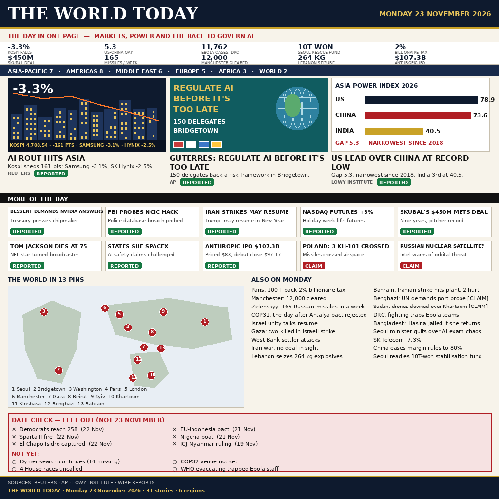

# THE WORLD TODAY — Monday 23 November 2026

23 November's world news in one image — an entry for the [make.fun news-image-20261123 bounty](https://make.fun/bounty/news-image-20261123).

## The day in one page

**Heroes:** the AI rout hits Asia (Kospi −3.3% to 4,708.54), Guterres calls to regulate AI before it's too late (Bridgetown summit, 150 delegates), and the US lead over China falls to a record low (Asia Power Index gap 5.3).

**31 stories** — 3 hero scenes, 10 cards, 18 more in the ALSO list — plus a DATE CHECK box that keeps out stories from other days (Democrats reach 258, the Sparta II fire, El Chapo Isidro captured, the EU–Indonesia pact, the Nigeria boat, the ICJ Myanmar ruling) and a NOT YET list for stories still developing.

## How it is built

- `draw.py` — draws the 1024×1024 front page with PIL.
- `main.py` — stdlib-only runner: validates the bundled `entry.png` (PNG header, chunk CRCs, dimensions, size, sha256) and writes a byte-identical copy to `$MAKEFUN_OUTPUT_DIR/entry.png`.
- `entry.png` — the finished image (1024×1024, ≤ 1 MiB).

## License

MIT — see [LICENSE](LICENSE).
